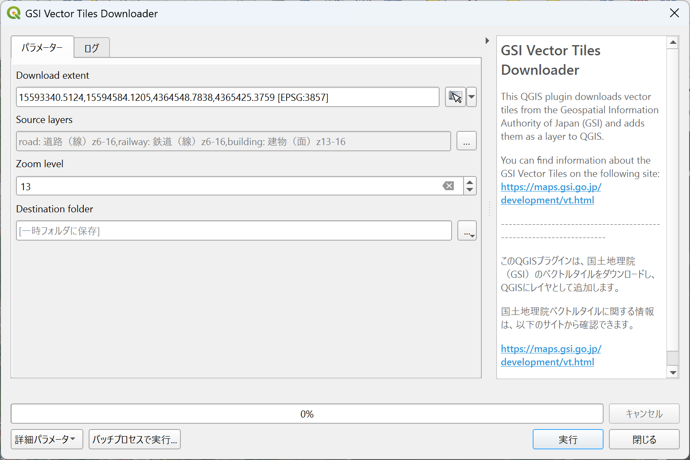

# GSI Vector Tiles Downloader

[English](#Overview) / [日本語](#概要)

## Overview

- This QGIS plugin downloads vector tiles from the Geospatial Information Authority of Japan (GSI) and adds them as a layer to QGIS.
- You can find information about the GSI Vector Tiles on the following site: https://maps.gsi.go.jp/development/vt.html


## Usage

- Click this icon on the QGIS plugin tool bar.


- You can also find it in the Processing Toolbox -> GSI vector tiles downloader.
- Set the following parameters:

  - (1) Download extent (By clicking the cursor icon on the right, the current map canvas extent will be selected)
  - (2) Source Layers
  - (3) Zoom level
  - (4) Output folder (if not specified, a temporary folder is used)

- Click Run.
- Each source layer is saved as `{layer}_z{zoom}.gpkg` in the output folder and added to the project.



### Processing

The algorithm `gsivtdl:gsi_vt_downloader` can also be used in the Graphical Modeler, batch processing, `processing.run()` and `qgis_process`.
`OUTPUT_LAYERS` returns the paths of the saved GeoPackages, and `OUTPUT_FOLDER` returns the output folder.
`processing.run()` does not add the layers to the project; use `processing.runAndLoadResults()` to add them.

```python
processing.run(
    "gsivtdl:gsi_vt_downloader",
    {
        "INPUT_EXTENT": "139.76,139.78,35.67,35.69 [EPSG:4326]",
        "SOURCE_LAYER": [2, 5],  # road, building
        "ZOOM_LEVEL": 16,
        "OUTPUT_FOLDER": "TEMPORARY_OUTPUT",
    },
)
```

```sh
qgis_process plugins enable gsivtdownloader
qgis_process run gsivtdl:gsi_vt_downloader -- "INPUT_EXTENT=139.76,139.78,35.67,35.69 [EPSG:4326]" SOURCE_LAYER=2,5 ZOOM_LEVEL=16 OUTPUT_FOLDER=/path/to/output
```

## 概要

- この QGIS プラグインは、国土地理院（GSI）のベクトルタイルをダウンロードし、QGIS にレイヤとして追加します。
- 国土地理院ベクトルタイルに関する情報は[ こちら ](https://maps.gsi.go.jp/development/vt.html)から確認できます。

## 使い方

- QGIS のツールバーにあるこのアイコンをクリックします。

  

- ［プロセッシングツールボックス］->［GSI vector tiles downloader］　でも探すことができます。
- 以下の情報を入力して、目的のベクトルタイルを選択します。

  - (1) ダウンロード範囲

    - 右側のカーソルアイコンをクリックすると、現在のマップキャンバスの範囲が選択されます。

  - (2) ソースレイヤ
    - [...]ボタンをクリックし、対象項目を選択
 
  - (3) ズームレベル
  - (4) 出力フォルダ
    - 指定しない場合、一時フォルダに出力

- ［実行］をクリックします。
- ソースレイヤごとに `{レイヤ名}_z{ズームレベル}.gpkg` として出力フォルダに保存され、プロジェクトに追加されます。


### プロセッシング

アルゴリズム `gsivtdl:gsi_vt_downloader` は、グラフィカルモデラー、バッチ処理、`processing.run()`、`qgis_process` からも使えます。
`OUTPUT_LAYERS` は保存した GeoPackage のパスを、`OUTPUT_FOLDER` は出力フォルダを返します。
`processing.run()` ではレイヤはプロジェクトに追加されません。追加する場合は `processing.runAndLoadResults()` を使います。使用例は [Processing](#processing) を参照してください。

## Authors

- Updated successor to [GSI-VTDownloader](https://github.com/Kanahiro/GSI-VTDownloader).
- MIERUNE Inc.
